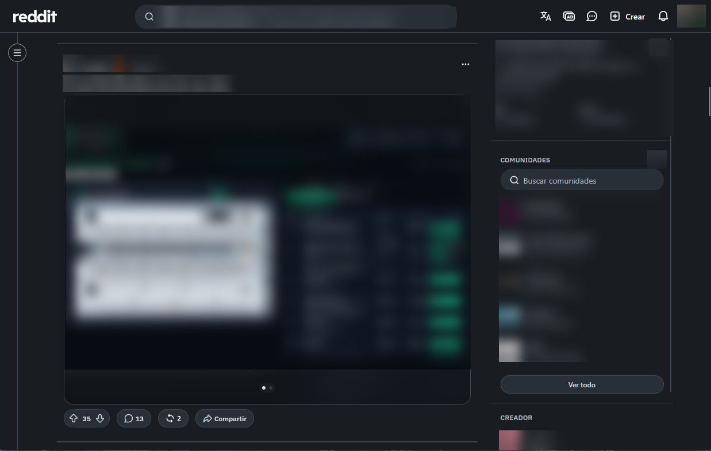
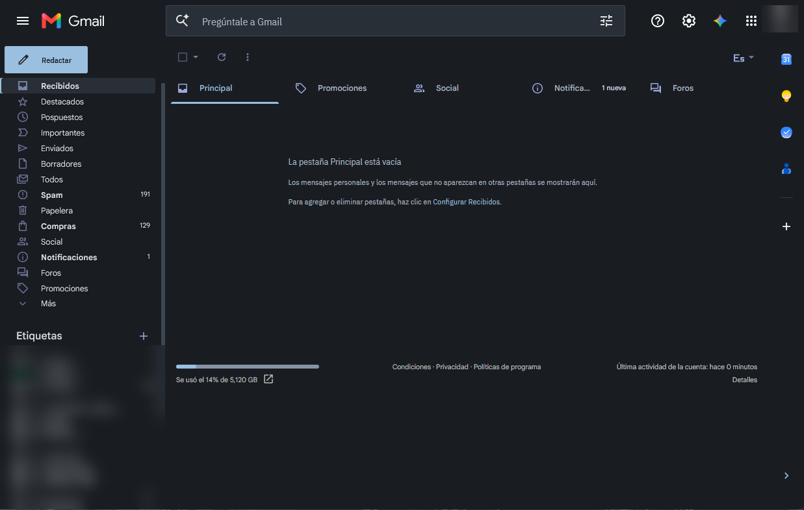
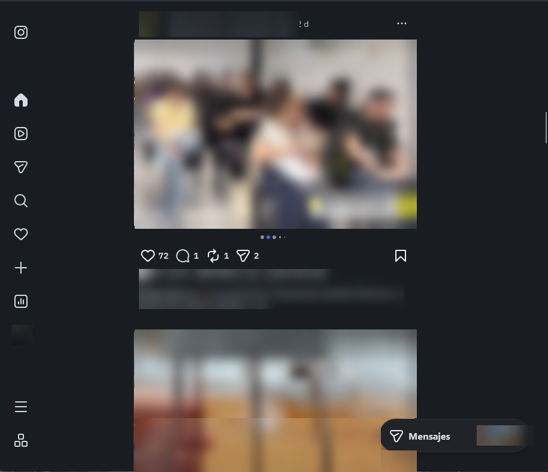
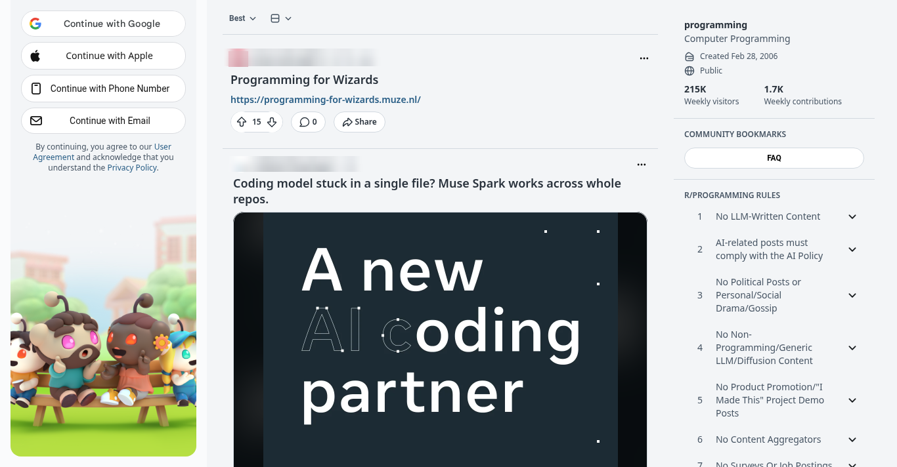

# Flatcap for Stylus

  

**Flatcap for Stylus** brings the Flatcap visual system to four websites through UserCSS: Gemini, Gmail, Instagram and Reddit. Matte surfaces, one mineral-blue accent, and an interface that stays in the background.

<p align="center">
  
</p>

> The interface organizes. Content takes the foreground. Color informs.

## Quiet precision

[Flatcap](https://github.com/cheycron/flatcap-theme) is a semantic visual system. Colors are named for **what they do**, and the two modes share roles rather than values: Daylight is not an inverted Slate. Each style keeps the selectors and behaviors it already had on the site; only the colors, fonts and focus treatment changed to Flatcap 2.0.

## Gallery

Captured by the author in Firefox on Windows with Stylus, in Slate. Personal data, avatars, third-party names, photos and post content are blurred.

| Gmail | Instagram |
| :---: | :---: |
|  |  |

**Daylight.** Only Reddit has a light capture, and it is a test render without a signed-in session (Google login popup cropped out), not a screenshot of the author's account. The other Daylight modes have no capture yet.



## Styles

| Site | File | What it does besides recoloring |
| :--- | :--- | :--- |
| **Gemini** | [`styles/gemini.google.com.user.less`](styles/gemini.google.com.user.less) | Hides upsell buttons and location footers; the prompt toolbar fades in on hover or focus. |
| **Gmail** | [`styles/gmail.com.user.less`](styles/gmail.com.user.less) | IBM Plex Sans Condensed for dense lists. The message body keeps its own light colors on purpose. |
| **Instagram** | [`styles/instagram.com.user.less`](styles/instagram.com.user.less) | Maps Instagram's color variables to Flatcap roles; sprites and logos are inverted in Slate only. |
| **Reddit** | [`styles/reddit.com.user.less`](styles/reddit.com.user.less) | Hides the home-feed right rail and widens the feed; community info panels stay. |

## Install

Requires [Stylus](https://add0n.com/stylus.html) ([Firefox](https://addons.mozilla.org/en-US/firefox/addon/styl-us/), [Chrome / Edge / Brave](https://chrome.google.com/webstore/detail/stylus/clngdbkpkpeebahjckkjfobafhncgmne)). Stylus recognizes `*.user.less` files natively.

Click a link below and Stylus opens its install page (Firefox may ask to confirm). Every style updates itself from the same `main` URL.

| Site | Install |
| :--- | :--- |
| Gemini | [gemini.google.com.user.less](https://raw.githubusercontent.com/cheycron/flatcap-userstyles/main/styles/gemini.google.com.user.less) |
| Gmail | [gmail.com.user.less](https://raw.githubusercontent.com/cheycron/flatcap-userstyles/main/styles/gmail.com.user.less) |
| Instagram | [instagram.com.user.less](https://raw.githubusercontent.com/cheycron/flatcap-userstyles/main/styles/instagram.com.user.less) |
| Reddit | [reddit.com.user.less](https://raw.githubusercontent.com/cheycron/flatcap-userstyles/main/styles/reddit.com.user.less) |

If the link opens as plain text, copy the URL and use Stylus → *Write new style* → *Import*, or clone the repository and drag a `styles/*.user.less` file onto a Firefox tab (Chromium: Stylus's [Installing local files](https://github.com/openstyles/stylus/wiki/Writing-UserCSS#installing-local-files)).

**Upgrading from v1.** The styles are renamed (`Flatcap — <Site>`) and share one namespace, so Stylus installs them as new styles. Disable or remove the old entries (*Gemini - Clean Flatcap*, *Gmail - Flatcap Theme*, *Instagram - Flatcap Theme*, *Reddit - Flatcap (Tokyo Port)*) to avoid two themes fighting over the same page.

## Options

Every style has two options in the Stylus config panel:

| Option | Values | Default |
| :--- | :--- | :--- |
| Color mode | Follow system, Slate (dark), Daylight (light) | Follow system |
| Load IBM Plex from Google Fonts | on / off | on |

*Follow system* emits both modes and lets `prefers-color-scheme` choose, so it switches live. Slate and Daylight force one mode and set `color-scheme` to match. The Gmail message body keeps its own light colors in every mode.

With the font option off, no request is made to Google Fonts and the stack falls back to the installed fonts (`IBM Plex Sans`, `IBM Plex Sans Condensed`, `Cascadia Code`, then system fonts).

## How colors are chosen

Every value comes from the Flatcap 2.0 core (`src/theme.json`) and is assigned **by role** inside each style, never by palette position. The old v1 names (`bg-main`, `act-primary`, …) were not translated one-to-one; each use was re-read for what it paints: canvas, panel, raised menu, hover row, selected row, link, filled action and its label, focus ring, selected text, feedback. The roles used, per mode:

<!-- build:roles -->
| Role | Slate | Daylight | Used by |
| :--- | :--- | :--- | :--- |
| `bg.canvas` | `#191D22` | `#F3F5F7` | gemini.google.com, gmail.com, instagram.com, reddit.com |
| `bg.surface` | `#20252B` | `#FAFBFC` | gemini.google.com, gmail.com, instagram.com, reddit.com |
| `bg.raised` | `#292F36` | `#FFFFFF` | gemini.google.com, gmail.com, instagram.com, reddit.com |
| `bg.hover` | `#323A43` | `#E6EBF0` | gmail.com, instagram.com, reddit.com |
| `bg.selected` | `#263E53` | `#DCE9F4` | gemini.google.com, gmail.com |
| `border.subtle` | `#3D4652` | `#D2D9E0` | gemini.google.com, gmail.com, instagram.com, reddit.com |
| `border.control` | `#8593A5` | `#6C7A89` | gemini.google.com, gmail.com, reddit.com |
| `text.primary` | `#D5DBE3` | `#28313B` | gemini.google.com, gmail.com, instagram.com, reddit.com |
| `text.secondary` | `#AEB8C4` | `#465463` | gemini.google.com, gmail.com, instagram.com, reddit.com |
| `text.muted` | `#A7B3C2` | `#536273` | instagram.com |
| `accent.fg` | `#9BBFDF` | `#285D85` | gemini.google.com, gmail.com, instagram.com, reddit.com |
| `accent.fill` | `#9BBFDF` | `#285D85` | gemini.google.com, gmail.com, reddit.com |
| `accent.hover` | `#ACCCE7` | `#214F73` | gmail.com, reddit.com |
| `accent.on` | `#101820` | `#FAFBFC` | gemini.google.com, gmail.com |
| `focus.ring` | `#B0D2F0` | `#285D85` | gmail.com, reddit.com |
| `success.fg` | `#9FC3AD` | `#32664D` | gmail.com, reddit.com |
| `warning.fg` | `#D8BC87` | `#765319` | gmail.com |
| `danger.fg` | `#E2A0A5` | `#A43F4A` | gemini.google.com, gmail.com, instagram.com, reddit.com |
| `selection.bg` | `#3C546B` | `#C8DDF0` | gmail.com, reddit.com |
| `selection.fg` | `#D5DBE3` | `#28313B` | gmail.com, reddit.com |
| `data.4` | `#D6AF95` | `#84533D` | reddit.com |
<!-- /build:roles -->

<!-- build:source -->
Token source: `src/theme.json`, Flatcap core 2.0.0 (`Flatcap`, Quiet precision — semantic tokens for focused work). Fonts: `font.ui` = "IBM Plex Sans", "Segoe UI", system-ui, sans-serif; `font.dense` = "IBM Plex Sans Condensed", "IBM Plex Sans", system-ui, sans-serif; `font.code` = "Cascadia Code", "Cascadia Code NF", "CaskaydiaCove Nerd Font Mono", ui-monospace, Consolas, monospace.
<!-- /build:source -->

Not covered: the core's increased-contrast overrides (`contrast.*`) are not wired into these styles, and the mapping reflects the roles the styles paint, not a pixel-level audit of the live sites.

## Accessibility

Text and control roles are chosen against the Flatcap contrast targets, checked by `python3 scripts/build.py --check` and reported in full by `--contrast`. Focus rings use the `focus.ring` role with a 2px width and offset. The core's increased-contrast overrides (`contrast.*`) are not wired in yet.

## Compatibility

Tested by the author in Firefox with Stylus on Gmail, Gemini, Instagram and Reddit (Slate). Daylight and *Follow system* compile and pass the build checks, but only Reddit Daylight has been rendered (without a session). The sites change their markup often, so a selector can stop matching; please open an issue. Chromium with Stylus should work but is untested.

## How it is built

`styles/*.user.less` are the installable files. The text between `flatcap:tokens:begin` and `flatcap:tokens:end` in each file is **generated** from `src/theme.json` (a versioned copy of the core) as two LESS mixins, `.fc-tokens-slate()` and `.fc-tokens-daylight()`. No hex value is written by hand outside it, apart from attribute selectors that match colors written by the sites themselves.

```
python3 scripts/build.py            # rewrite generated blocks
python3 scripts/build.py --check    # stale blocks, stray hex, metadata drift, contrast targets
python3 scripts/build.py --sync     # refresh src/theme.json from ../00-Flatcap, then rebuild
python3 scripts/build.py --contrast # full contrast report for the roles the styles use
```

Python 3.10+, standard library only. The styles are LESS (`@preprocessor less`); Stylus compiles them with less.js and passes the options as variables.

## License

The Flatcap-authored changes are © Cheycron Blaine and offered under the [MIT License](LICENSE).

Three of the four styles derive from third-party UserStyles, credited in full in [NOTICE.md](NOTICE.md): Reddit (JoshuaMarkle), Gmail (Catppuccin) and, published here with the author's decision, **Gemini** (*gemini clean* by [sonho](https://userstyles.world/style/25979)) and **Instagram** (*Dark & simple instagram* by [sergio9929](https://userstyles.world/style/536/dark-simple-instagram)). Those two upstreams do not declare a clear license, so their parts are **not covered by the MIT grant** and no extra permission is claimed. If an original author asks, the style is adjusted or removed.

## Support

Issues and suggestions: [GitHub issues](https://github.com/cheycron/flatcap-userstyles/issues).

<p align="center">
  <a href="https://www.buymeacoffee.com/cheycron">
    
  </a>
</p>
